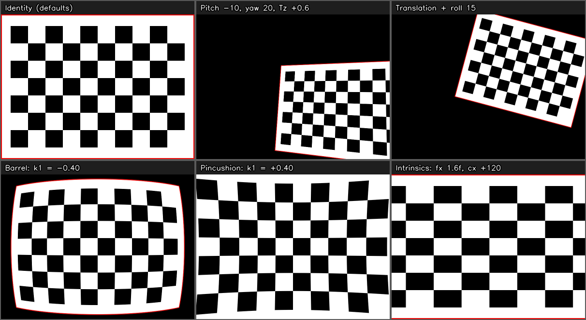

# Camera Geometry Playground


A small, dependency-light playground to **see what camera-model parameters do to an image**, in real time.

The input image is treated as a flat object placed in 3D space. A *virtual pinhole camera* looks at it, and you control the model with sliders: position, orientation, focal length, optical center and radial lens distortion. Every slider movement re-renders the result immediately.

**Important:** this is a visualization and learning tool, **not a camera-calibration estimator**. It does not detect chessboard corners, estimate parameters from captured images, minimize reprojection error, or generate a calibration file. Pressing `s` prints the values currently selected with the sliders; those values are not inferred from the image. Use the playground to build intuition before or alongside a real calibration workflow.



*Example outputs produced by the same pipeline the app uses: default parameters, a pose change, a translation + roll, barrel and pincushion distortion, and an intrinsics change.*

---

## Table of contents

- [Features](#features)
- [Quick start](#quick-start)
- [Controls](#controls)
- [The math behind it](#the-math-behind-it)
- [Code structure](#code-structure)
- [Robustness: what happens at the slider extremes](#robustness-what-happens-at-the-slider-extremes)
- [Limitations and design notes](#limitations-and-design-notes)
- [Customization](#customization)
- [Troubleshooting](#troubleshooting)
- [Experiments to try](#experiments-to-try)
- [License](#license)

---

## Features

- **13 live parameters** on a dedicated control window: translation (`Tx`, `Ty`, `Tz`), Euler rotation (pitch, yaw, roll), intrinsics (`fx`, `fy`, `cx`, `cy`) and radial distortion (`k1`, `k2`, `k3`).
- **Identity by default**: with the sliders at their initial positions the output equals the input image, so each change is easy to inspect.
- **Camera-model geometry**: a plane-to-image homography built from `K`, `R`, `T`, applied with `cv2.warpPerspective`, followed by radial distortion applied with `cv2.remap`.
- **Bounded controls**: ranges are limited, degenerate poses are detected and reported on screen, and distortion math is clamped against NaN/inf.
- **Export for inspection**: press `s` to save the current rendered image and print the current `K`, `R`, `T` and `distCoeffs` values. These are slider-selected values, not calibration estimates.
- **Single Python file, two dependencies** (`numpy`, `opencv-python`), with comments explaining the pipeline.

---

## Quick start

```bash
# 1. Clone the repository
git clone https://github.com/sibiliatommaso/camera-geometry-playground.git
cd camera-geometry-playground

# 2. (Recommended) create a virtual environment
python -m venv .venv
source .venv/bin/activate        # Windows: .venv\Scripts\activate

# 3. Install the dependencies
pip install -r requirements.txt

# 4. Run
python camera_calibration_lab.py
```

By default the script loads `img/scacchiera.jpg` (a sample chessboard included in the repo). To use your own picture:

```bash
python camera_calibration_lab.py path/to/your_image.jpg
```

If the file cannot be read, the program prints a warning and falls back to a synthetic chessboard, so it always starts.

> **Note:** install `opencv-python`, **not** `opencv-python-headless`. The headless build has no GUI support and cannot open windows or trackbars.

Two windows open: **Camera Lab - Output** (the image) and **Camera Lab - Controls** (the sliders).

---

## Controls

### Keyboard (focus the image window)

| Key | Action |
|-----|--------|
| `r` | Reset all sliders to their defaults |
| `s` | Save the current output to `calibration_lab_output.png` and print the current `K`, `R`, `T`, `distCoeffs` values in the terminal |
| `h` | Show / hide the parameter overlay |
| `q` or `ESC` | Quit (closing either window also quits) |

### Sliders

OpenCV trackbars only support integers, so each slider is mapped linearly onto a real range (`value = min + position * step`). The current real values are shown in the overlay on the image. In the table, `f₀ = max(width, height)` of the loaded image.

| Group | Slider | Range | Step | Default | Meaning |
|-------|--------|-------|------|---------|---------|
| Translation | `Tx` | -2 … 2 | 0.01 | 0 | Shift along the camera X axis (plane depth units) |
| | `Ty` | -2 … 2 | 0.01 | 0 | Shift along the camera Y axis |
| | `Tz` | -0.9 … 4 | 0.01 | 0 | Shift along the optical axis. Plane depth becomes `1 + Tz` |
| Rotation | `Pitch X` | -85° … 85° | 0.5° | 0 | Rotation around X |
| | `Yaw Y` | -85° … 85° | 0.5° | Rotation around Y |
| | `Roll Z` | -180° … 180° | 0.5° | Rotation around Z (optical axis) |
| Intrinsics | `fx` | 0.25 f₀ … 4 f₀ | 1 px | f₀ | Focal length (x), in pixels |
| | `fy` | 0.25 f₀ … 4 f₀ | 1 px | f₀ | Focal length (y), in pixels |
| | `cx` | 0 … width | 1 px | width / 2 | Optical center x |
| | `cy` | 0 … height | 1 px | height / 2 | Optical center y |
| Distortion | `k1` | -1 … 1 | 0.01 | 0 | Radial coefficient r² |
| | `k2` | -1 … 1 | 0.01 | 0 | Radial coefficient r⁴ |
| | `k3` | -1 … 1 | 0.01 | 0 | Radial coefficient r⁶ |

In this OpenCV-style radial model, `k1 < 0` commonly gives **barrel** distortion and `k1 > 0` commonly gives **pincushion** distortion.

---

## The math behind it

### 1. Scene model

The image is a rectangle lying on the plane `Z = Z₀` (here `Z₀ = 1`) in a world frame whose origin is the camera center. A world point `X` is expressed in the camera frame as

$$
\mathbf{X}_c = R\,\mathbf{X} + T
$$

so `R` and `T` describe the pose of the plane relative to the camera. With `T = 0` the effect is a pure camera rotation about its optical center.

### 2. Intrinsic matrix

$$
K = \begin{bmatrix} f_x & 0 & c_x \\ 0 & f_y & c_y \\ 0 & 0 & 1 \end{bmatrix}
$$

### 3. Rotation from Euler angles

Each elementary rotation is built from a Rodrigues vector (`axis * angle`) with `cv2.Rodrigues`, then composed as

$$
R = R_z(\text{roll})\,R_y(\text{yaw})\,R_x(\text{pitch})
$$

### 4. Plane-to-image homography

A point on the plane is `X = (x, y, Z₀)ᵀ`, therefore

$$
\mathbf{X}_c = x\,\mathbf{r}_1 + y\,\mathbf{r}_2 + (Z_0\,\mathbf{r}_3 + T)
$$

where `r₁, r₂, r₃` are the columns of `R`. Projecting with `K` gives the homography from plane coordinates to output pixels:

$$
H_{\text{plane}\to\text{img}} = K\,[\,\mathbf{r}_1 \mid \mathbf{r}_2 \mid Z_0\mathbf{r}_3 + T\,]
$$

The source pixels `(u, v)` are mapped to plane coordinates by a matrix `M` (centering the image on the optical axis and scaling it by the reference focal length `f₀`). The matrix used by `cv2.warpPerspective` is

$$
H = K\,[\,\mathbf{r}_1 \mid \mathbf{r}_2 \mid Z_0\mathbf{r}_3 + T\,]\,M
$$

**Sanity checks**

- With the default values (`R = I`, `T = 0`, `f = f₀`, `c = (w/2, h/2)`), `H` is the identity.
- With `T = 0`, `H = K R K₀⁻¹`, where `K₀` is the default intrinsic matrix: the classic pure-rotation homography.

### 5. Radial distortion

The radial model maps ideal normalized coordinates to distorted ones:

$$
\mathbf{x}_d = \mathbf{x}_u\,(1 + k_1 r^2 + k_2 r^4 + k_3 r^6), \qquad r^2 = x_u^2 + y_u^2
$$

`cv2.remap` is a backward mapping: for every destination pixel it needs the corresponding source position. The code approximates the inverse of the radial polynomial with a fixed-point iteration. This is a visualization-oriented implementation; extreme coefficients may exceed the range where the approximation is geometrically accurate.

---

## Code structure

Everything currently lives in `camera_calibration_lab.py`.

| Function | Role |
|----------|------|
| `load_image` | Loads and (if needed) downscales the image; falls back to a synthetic chessboard |
| `make_slider_specs` | Single source of truth for each slider: name, range, step, default |
| `read_params` | Reads trackbar positions and converts them to real values |
| `build_intrinsics` | Builds `K` |
| `euler_to_rotation` | Euler angles → `R` using `cv2.Rodrigues` |
| `build_homography` | Builds the plane-to-image homography |
| `homography_is_valid` | Rejects singular / behind-the-camera configurations |
| `apply_radial_distortion` | Builds a remapping grid and applies radial distortion |
| `render` | Runs the pipeline for one parameter set |
| `main` | Window creation, trackbars, event loop |

---

## Robustness: what happens at the slider extremes

| Risk | Protection |
|------|-----------|
| Plane edge-on or behind the camera | Rotation is limited; invalid poses are reported instead of rendering unstable results |
| Singular or ill-conditioned `H` | Checked before warping |
| Division by zero or invalid distortion factor | Distortion factor is bounded; NaN/inf values are handled |
| Unexpected OpenCV error | Caught in the main loop where supported |

---

## Limitations and design notes

- **Pinhole model + radial distortion only.** There is no skew and no tangential distortion (`p1 = p2 = 0` in the displayed/exported values).
- **The whole plane must be in front of the camera.** If any image corner crosses the camera plane, the pose is flagged invalid instead of showing a partial render.
- **Large `k` values.** For strong coefficients the radial polynomial may not be monotonic, so the fixed-point inversion may not converge everywhere. The output is guarded against invalid numeric values but may no longer be geometrically exact.
- **Image is downscaled** to at most 900 px on the longest side to keep the UI responsive. Pixel-based ranges refer to the downscaled size.
- **This is not a calibration pipeline.** It does not infer intrinsics or distortion coefficients from a chessboard, compute reprojection error, or validate a real camera's calibration.

---

## Customization

The main constants are near the top of the Python file:

| Constant | Default | Effect |
|----------|---------|--------|
| `MAX_DIM` | `900` | Maximum image size before downscaling |
| `Z_PLANE` | `1.0` | Depth of the image plane |
| `EPS_DEPTH` | `1e-3` | Minimum corner depth for a pose to be valid |
| `MAX_COND` | `1e10` | Maximum condition number of `H` |
| `DIST_ITERS` | `8` | Iterations for the distortion inversion |

To change a slider range, edit its row in `make_slider_specs()`.

---

## Troubleshooting

| Problem | Solution |
|---------|----------|
| OpenCV GUI error mentioning missing Windows, GTK+ or Cocoa support | You likely installed `opencv-python-headless`. Uninstall it and install `opencv-python`. |
| Control window shows no sliders or they look squashed | Resize the Controls window |
| Window does not open on a remote server / WSL / Docker | The app needs a display; use a local desktop session, X forwarding or WSLg |
| `Cannot read 'img/scacchiera.jpg'` | Run the script from the repository root, or pass the image path explicitly |
| Black image with `INVALID POSE` | The plane is behind the camera or edge-on. Reduce rotation or increase `Tz` |
| Qt / Wayland errors on Linux | Try `QT_QPA_PLATFORM=xcb python camera_calibration_lab.py` |

---

## Experiments to try

1. **Zooming vs. moving closer.** For a frontal plane, the image scale depends on `f / (1 + Tz)`. Change focal length and depth to compare.
2. **Optical center.** Move `cx`, `cy` and notice the image shifts without a perspective change.
3. **Barrel vs. pincushion.** Sweep `k1` from negative to positive and watch straight chessboard lines bend.
4. **Rotation vs. translation.** Compare `Yaw` with `Tx`. Rotation changes orientation; translation changes the plane's position.
5. **Understand a real calibration.** If you have `K` and `distCoeffs` from a separate `cv2.calibrateCamera` run, use the playground to explore their visual effects. It does not validate that calibration, and the tangential coefficients `p1` and `p2` are not modelled.

---

## License

Released under the MIT License. See [`LICENSE`](LICENSE).

If you use this tool in teaching material or a publication, please link back to this repository:

https://github.com/sibiliatommaso/camera-geometry-playground
